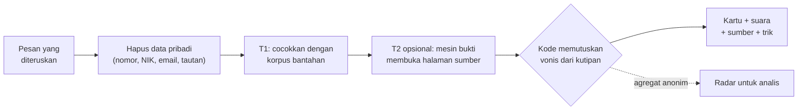

<div align="center">


# halio.

**Teman cek pesan untuk keluarga Indonesia.**<br>
Berhenti sebentar. Tanya Halio. Baru bagikan.

[](https://github.com/Ardelyo/halio/actions/workflows/ci.yml)
[](LICENSE)


[Tonton video demo](https://youtu.be/s2EMpZI2r4g) · [Coba sekarang](#coba-sekarang) · [Panduan untuk juri](docs/submission/UNTUK_JURI.md) · [Semua dokumen](docs/README.md)


*Kartika Cyber Hackathon 2026 · Kategori Siber Sosial*

</div>

## Masalah

Pesan berantai menyebar di grup keluarga karena orang peduli, bukan karena bodoh. Satu pesan yang salah, misalnya surat kelulusan palsu atau bantuan tunai palsu, bisa membuat keluarga panik atau kehilangan uang. Bantahan resmi jarang sampai ke tempat pesan itu beredar, dan penipuan yang mencatut nama TNI AD termasuk di antaranya.

## Solusi

Ibu atau Bapak cukup **meneruskan** pesan yang meragukan ke Halio lewat Telegram atau web. Halio menjawab dalam bahasa sehari-hari:

| | Yang diterima pengguna |
|---|---|
| 🔊 | **Pesan suara** yang ramah untuk orang tua |
| 🖼️ | **Kartu Halio** seukuran WhatsApp untuk meluruskan di grup keluarga |
| 📎 | **Sumber bernama** dari pemeriksa fakta atau lembaga resmi, bisa dibuka |
| 🧠 | **Trik manipulasi** yang dipakai pesan itu, supaya belajar mengenalinya |

Bila belum ada pemeriksaan, Halio berkata jujur: **"Halio tidak mau menebak"**, lalu menawarkan pemeriksa manusia.

Dari cek-cek warga itu, **Radar Ketahanan Kognitif** menunjukkan kepada analis kabar apa yang sedang naik dan trik apa yang dipakai, termasuk lonjakan penipuan yang mencatut TNI AD. Radar tidak membaca pesan pribadi: isi kabar baru muncul hanya setelah dilaporkan banyak orang berbeda (k-anonimitas).

## Cara kerja



**AI hanya mencari dan membaca bukti. Vonis diputuskan kode.** Kutipan disalin kode dari halaman yang dibuka kode, lalu dicocokkan ulang kata per kata. Kalimat yang tidak didukung kutipan dibuang.

## Lima keadaan jawaban

| | Status | Artinya |
|---|---|---|
| 🔴 | **Terbukti salah** | Sudah dibantah oleh pemeriksa fakta atau sumber resmi yang disebutkan |
| 🟢 | **Sejalan dengan sumber** | Sumber resmi yang masih berlaku memuat kutipan yang mendukung seluruh klaim. Bukan stempel "pasti benar": cek tanggal dan konteksnya |
| 🔵 | **Dilaporkan media** | Diberitakan media, tetapi ini bukan pemeriksaan fakta |
| 🟠 | **Halio tidak yakin** | Mirip kabar bohong tapi tidak sama persis, bukti bertentangan atau kedaluwarsa, atau bukan klaim faktual |
| ⚪ | **Belum ada pemeriksaan** | Belum ada sumber yang cocok; Halio tidak menebak |

Ada lima keadaan karena kabar yang benar tidak boleh dicap hoaks, dan tidak ada bantahan bukan berarti benar. Alasannya ada di [Kalau informasinya benar, bagaimana?](docs/TRUE_INFORMATION.md). Pada mode tanpa AI, hanya tiga keadaan yang bisa muncul: terbukti salah, tidak yakin, dan belum ada pemeriksaan.

## Kenapa bisa dipercaya

| Prinsip | Bagaimana dijaga |
|---|---|
| **Sumber nyata** | Tautan hanya dari halaman yang benar-benar dibuka kode. Halaman dari situs tak dikenal tidak bisa menjadi bukti |
| **Berani bilang belum tahu** | "Belum ada pemeriksaan" adalah jawaban yang sah, bukan kegagalan |
| **Privasi sejak awal** | Nomor, NIK, email, rekening, tautan, dan @akun dihapus sebelum diproses. Maksimal 300 karakter klaim yang dikirim ke cloud |
| **Netral** | Halio memeriksa klaim, bukan orang. Tidak ada akun atau prajurit yang diprofilkan |

## Bukti dalam angka

| Angka | Arti | Sumber |
|---|---|---|
| **266** | Tes otomatis lulus, dijalankan CI pada setiap perubahan | [CI](.github/workflows/ci.yml) |
| **0 dari 70** | Pernyataan benar atau belum dikenal yang salah dicap "terbukti salah" (dua set uji tulisan tim) | [eval/RESULTS.md](eval/RESULTS.md) |
| **0 dari 1.043** | Judul TurnBackHoax berlabel BENAR atau KLARIFIKASI yang salah dicap "terbukti salah", pada sampel publik yang tidak dipakai menyetel Halio (satu kesalahan ditemukan lalu diperbaiki, lihat catatan di laporan) | [eval/PUBLIC_RESULTS.md](eval/PUBLIC_RESULTS.md) |
| **88%** | Recall parafrase hoaks pada set holdout | [eval/RESULTS.md](eval/RESULTS.md) |
| **0,9 ms** | Median pencocokan lokal tanpa AI | [Arsitektur](docs/ARCHITECTURE.md) |
| **23** | Feed terbuka yang dipantau sensor (opsional) | [Arsitektur sensor](docs/ARCHITECTURE_SENSOR.md) |

## Batas yang kami akui

- Ini purwarupa. Set uji ditulis tim sendiri, jadi angkanya **bukan** akurasi dunia nyata.
- Korpus bantahan kurasi baru **7 entri**. Di luar korpus, Halio memakai pencarian bukti atau berkata belum tahu.
- Belum ada uji dengan pengguna lansia sungguhan; lembar ujinya sudah siap.
- Data Radar pada demo adalah **simulasi** dan diberi label.
- Halio membaca isi teks, foto, dan suara, tetapi **tidak menilai keaslian** foto atau video, dan tidak mendeteksi deepfake.
- Telegram dan web aktif. Kode kanal WhatsApp (webhook Meta) tersedia dan membutuhkan token Meta milik pemakai.

## Coba sekarang

| Kanal | Tautan |
|---|---|
| Server publik (API, kartu, suara, dan Telusur berjalan sungguhan) | [Cek pesan](https://halio.ardelyo.com/cek.html) · [Uji keamanan](https://halio.ardelyo.com/uji.html) |
| Bot Telegram | [@halioid_bot](https://t.me/halioid_bot) (aktif selama proses bot dan API berjalan) |
| Landing page | [ardelyo.github.io/halio](https://ardelyo.github.io/halio/) |
| Demo di GitHub Pages (simulasi, tanpa server) | [Cek pesan](https://ardelyo.github.io/halio/cek.html) · [Radar](https://ardelyo.github.io/halio/radar.html) · [Cakupan sensor](https://ardelyo.github.io/halio/coverage.html) · [Feed untuk ekstensi](https://ardelyo.github.io/halio/demo-feed.html) |

GitHub Pages menjalankan skenario lokal berlabel simulasi dan tidak mengirim pesan ke server. Situs dideploy otomatis dari `web/` oleh `.github/workflows/pages.yml`.

## Jalankan sendiri

<details>
<summary><b>Backend dan web</b></summary>

```bash
cd backend
pip install -r requirements.txt            # opsional: pip install -r requirements-optional.txt
uvicorn halio.api:app --reload             # http://localhost:8000 , /radar , /demo-feed.html

python ../scripts/seed_demo.py             # isi Radar dengan data SIMULASI (diberi label)
python -m pytest                           # tes unit dan API
python ../eval/run_eval.py                 # evaluasi jujur → eval/RESULTS.md
```

</details>

<details>
<summary><b>Bot Telegram</b></summary>

Token didapat dari @BotFather.

```bash
cd backend
set TELEGRAM_BOT_TOKEN=...      # PowerShell: $env:TELEGRAM_BOT_TOKEN="..."
python -m halio.channels.telegram
```

</details>

<details>
<summary><b>Docker (server satuan, tanpa GPU)</b></summary>

```bash
cp .env.example .env
docker compose up -d
```

Profil tanpa cloud dan cloud opsional dijelaskan di [Profil penerapan](docs/PROFIL_PENERAPAN.md).

</details>

<details>
<summary><b>Antrean pemeriksa manusia</b></summary>

Tersedia di **Radar analis** (`/radar` atau `radar.html`): buka tiket, tulis respons, kirim bila kanal mendukung, dan periksa riwayat tindakan. Endpoint review memakai token Radar yang sama; jangan membukanya tanpa `RADAR_TOKEN` di server publik. CLI tersedia di server tepercaya:

```bash
python scripts/review.py list escalations
python scripts/review.py resolve escalations ID --response "Jawaban pemeriksa"
```

Balasan Telegram atau WhatsApp dikirim sebelum tiket ditutup, dan kegagalan pengiriman membuat tiket tetap terbuka. Kanal web memerlukan tindak lanjut manual dengan nomor tiket. Batas risiko dan gerbang peluncuran ada di [Kesiapan demo dan peluncuran](docs/LAUNCH_READINESS.md).

</details>

<details>
<summary><b>Sensor feed terbuka dan ekstensi Chrome</b></summary>

Halio dapat memantau **23 feed terbuka** (berita, cek fakta, sumber resmi) hampir realtime dengan `HALIO_SENSOR=1`. Halaman **Cakupan** menunjukkan terus terang mana yang hidup, mana yang basi, dan titik buta yang diakui (WhatsApp privat, Meta, TikTok, X, dan lainnya). Rancangannya ada di [Arsitektur sensor](docs/ARCHITECTURE_SENSOR.md). Ekstensi Chrome: [extension/README.md](extension/README.md).

</details>

## Isi repositori

```
backend/halio/       pipeline cek (klaim, PII, retrieval, mesin bukti, vonis), kartu, suara, Radar, kanal
backend/halio/ingest/  sensor: polling feed terbuka dan laporan cakupan
backend/tests/       266 tes otomatis
data/debunks.json    korpus bantahan bersumber
eval/                set uji dan evaluasi (tingkat salah tuduh hoaks)
web/                 PWA cek pesan, Radar, laporan analis, feed simulasi
extension/           ekstensi Chrome MV3 (lencana dan blur di perangkat)
scripts/             seed data simulasi, preflight, antrean review, thumbnail
deploy/              skrip dan unit layanan server (GCE, Caddy, systemd)
docs/                arsitektur, privasi, bukti uji, panduan, materi pengumpulan
```

## Dokumentasi

Pilih jalur sesuai kebutuhan. Peta lengkap beserta jenis tiap dokumen ada di [docs/README.md](docs/README.md).

| Saya ingin... | Mulai dari |
|---|---|
| Menilai karya ini | [Halio dalam lima menit](docs/submission/UNTUK_JURI.md), lalu [Arsitektur](docs/ARCHITECTURE.md) dan [Bukti uji](docs/BUKTI_UJI_DEMO.md) |
| Memahami cara kerja dan batasnya | [Arsitektur](docs/ARCHITECTURE.md), [Halio Telusur](docs/ARCHITECTURE_AGENT.md), [Privasi](docs/PRIVACY.md) |
| Menerapkan di satuan | [Profil penerapan](docs/PROFIL_PENERAPAN.md), [Kesiapan peluncuran](docs/LAUNCH_READINESS.md), [Pembaruan deploy](docs/DEPLOY_UPDATE.md) |
| Berkontribusi | [CONTRIBUTING.md](CONTRIBUTING.md) |

## Hak kekayaan intelektual dan lisensi

Sesuai Rulebook §N, HKI atas karya ini tetap milik tim. Kode dan dokumen di repo ini dirilis dengan [Lisensi Apache 2.0](LICENSE). Lisensi ini tidak mengalihkan HKI. Penyelenggara tetap berhak menampilkan dan memublikasikan karya untuk keperluan lomba, dan PUSSIBERAD dapat mengadopsi idenya melalui diskusi dengan tim (Rulebook §N).

Komponen pihak ketiga (pustaka, API, model, font, sumber korpus) memakai lisensi masing-masing; lihat [Atribusi pihak ketiga](docs/THIRD_PARTY.md). Isi artikel sumber bantahan tidak termasuk dalam lisensi ini: korpus hanya memuat ringkasan kata sendiri dan tautan.
